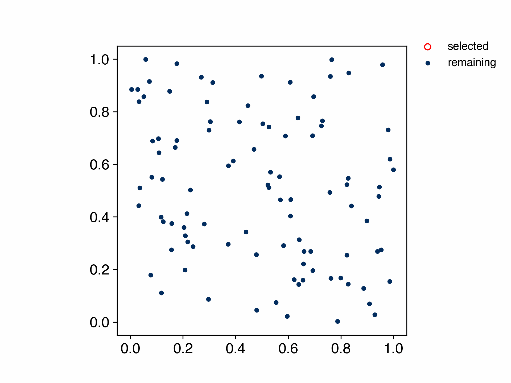

# Kennard Stone

[](https://pypi.org/project/kennard-stone/)
[](https://pypi.org/project/kennard-stone/)
[](https://pypi.org/project/kennard-stone/)
[](https://pepy.tech/project/kennard-stone)

[](https://github.com/yu9824/kennard_stone/actions/workflows/CI.yml)
[](https://github.com/yu9824/kennard_stone/actions/workflows/docs.yml)
[](https://github.com/yu9824/kennard_stone/actions/workflows/release.yml)

[](https://anaconda.org/conda-forge/kennard-stone)
[](https://anaconda.org/conda-forge/kennard-stone)

[](https://github.com/astral-sh/ruff)
[](https://github.com/python/mypy)

## What is this?

This is an algorithm for evenly partitioning data in a `scikit-learn`-like interface.
(See [References](#References) for details of the algorithm.)



## How to install

### PyPI

```bash
pip install kennard-stone
```

The project site is [here](https://pypi.org/project/kennard-stone/).

### Anaconda

```bash
conda install -c conda-forge kennard-stone
```

The project site is [here](https://anaconda.org/conda-forge/kennard-stone).

You need `numpy>=1.20` and `scikit-learn` to run.

## How to use

You can use them like [scikit-learn](https://scikit-learn.org/stable/modules/classes.html#module-sklearn.model_selection).

See the [documentation](https://yu9824.github.io/kennard_stone/) for the API reference and tutorials.

In the following, `X` denotes an arbitrary explanatory variable and `y` an arbitrary objective variable.
And, `estimator` indicates an arbitrary prediction model that conforms to scikit-learn.

### train_test_split

#### kennard_stone

```python
from kennard_stone import train_test_split

X_train, X_test, y_train, y_test = train_test_split(X, y, test_size=0.2)
```

#### scikit-learn

```python
from sklearn.model_selection import train_test_split

X_train, X_test, y_train, y_test = train_test_split(
    X, y, test_size=0.2, random_state=334
)
```

### KFold

#### kennard_stone

```python
from kennard_stone import KFold

# Always shuffled and uniquely determined for a data set.
kf = KFold(n_splits=5)
for i_train, i_test in kf.split(X, y):
    X_train = X[i_train]
    y_train = y[i_train]
    X_test = X[i_test]
    y_test = y[i_test]
```

#### scikit-learn

```python
from sklearn.model_selection import KFold

kf = KFold(n_splits=5, shuffle=True, random_state=334)
for i_train, i_test in kf.split(X, y):
    X_train = X[i_train]
    y_train = y[i_train]
    X_test = X[i_test]
    y_test = y[i_test]
```

### Other usages

If you ever specify `cv` in scikit-learn, you can assign `KFold` objects to it and apply it to various functions.

An example is [`cross_validate`](https://scikit-learn.org/stable/modules/generated/sklearn.model_selection.cross_validate.html).

#### kennard_stone

```python
from kennard_stone import KFold
from sklearn.model_selection import cross_validate

kf = KFold(n_splits=5)
print(cross_validate(estimator, X, y, cv=kf))
```

#### scikit-learn

```python
from sklearn.model_selection import KFold
from sklearn.model_selection import cross_validate

kf = KFold(n_splits=5, shuffle=True, random_state=334)
print(cross_validate(estimator, X, y, cv=kf))
```

OR

```python
from sklearn.model_selection import cross_validate

print(cross_validate(estimator, X, y, cv=5))
```


## Notes

There is no notion of `random_state` or `shuffle` because the partitioning is determined uniquely for the dataset.
If these arguments are included, they do not cause an error. They simply have no effect on the result. Please be careful.

To run the tutorial notebooks in `docs_src/tutorials`, install the extra dependencies with `pip install "kennard-stone[example]"`.

## Changes in v4.0.0

- `KFold` with `n_splits >= 3` returns different folds from v3.
  Each fold takes the remaining sample farthest from its own selected samples,
  but in v3 the third and later folds could skip their best candidates.
  `KFold` with `n_splits=2` and `train_test_split` are not affected.
  To reproduce the folds of v3, use `kennard-stone<4`.
- Python 3.8 and 3.9 are no longer supported. Python 3.10 or later is required.

Since v3.1.0, `KFold` no longer puts a sample in two test folds (which left another sample in none).
On datasets where that happened, the folds differ from earlier versions.

## Scaling and initial points (since v3.1.0)

### Scaling

Before computing distances, features with zero variance are dropped and the remaining features are standardized with `StandardScaler`.
Set `scale=False` to keep the original feature scales (zero-variance features are still dropped).

```python
X_train, X_test, y_train, y_test = train_test_split(X, y, test_size=0.2, scale=False)
kf = KFold(n_splits=5, scale=False)
```

### Initial points

`train_test_split` can choose how the selection starts with `init`.
In both cases, the selection then repeatedly adds the sample whose distance to its nearest selected sample is the largest.

- `init="farthest_from_mean"` (default): start from the sample farthest from the mean of the data.
- `init="farthest_pair"`: start from the two samples with the largest mutual distance, as in the original paper (Kennard & Stone, 1969).

```python
X_train, X_test, y_train, y_test = train_test_split(X, y, test_size=0.2, init="farthest_pair")
```

`KFold` always uses `"farthest_from_mean"`: each fold starts from one of the `n_splits` samples farthest from the mean.

## Distance metrics

See the documentation of

- `scipy.spatial.distance.pdist`
    https://docs.scipy.org/doc/scipy/reference/generated/scipy.spatial.distance.pdist.html
- `sklearn.metrics.pairwise_distances`
    https://scikit-learn.org/stable/modules/generated/sklearn.metrics.pairwise_distances.html

Valid values for metric are:

- From scikit-learn: ['cityblock', 'cosine', 'euclidean', 'l1',
    'l2', 'manhattan']. These metrics support sparse matrix inputs.
    ['nan_euclidean'] but it does not yet support sparse matrices.
- From scipy.spatial.distance: ['braycurtis', 'canberra',
    'chebyshev', 'correlation', 'dice', 'hamming', 'jaccard',
    'mahalanobis', 'minkowski', 'rogerstanimoto',
    'russellrao', 'seuclidean', 'sokalmichener', 'sokalsneath',
    'sqeuclidean', 'yule'] See the documentation for
    scipy.spatial.distance for details on these metrics.
    These metrics do not support sparse matrix inputs.

    Note: 'sokalmichener' is not available with SciPy >= 1.17
    because it has been removed from SciPy.

, by default "euclidean"

## Parallelization (since v2.1.0)

This algorithm is very computationally intensive and takes a lot of time.
To solve this problem, I have implemented parallelization and optimized the algorithm since v2.1.0.
`n_jobs` can be specified for parallelization as in the scikit-learn-like api.

```python
# parallelization KFold
kf = KFold(n_splits=5, n_jobs=-1)

# parallelization train_test_split
X_train, X_test, y_train, y_test = train_test_split(
    X, y, test_size=0.2, n_jobs=-1
)
```

The parallelization is used when calculating the distance matrix,
so it doesn't conflict with something like `cross_validate`  in parallel when using `KFold`.

```python
# OK: does not conflict each other
cross_validate(estimator, X, y, cv=KFold(5, n_jobs=-1), n_jobs=-1)
```


## Using GPU

If you have a GPU and have installed pytorch,
you can use it to calculate Minkowski distances (Manhattan, Euclidean, and Chebyshev distances).


```python
X_train, X_test, y_train, y_test = train_test_split(
    X, y, test_size=0.2, device="cuda"
)

```

Note: the CI has no GPU, so the GPU code path is not tested there.
The GPU tests in `tests/gpu` run only on a machine with PyTorch and an available GPU (CUDA or Apple MPS), and are skipped otherwise.
If you find a problem with the GPU path, please open an issue.


## LICENSE

MIT Licence

Copyright (c) 2021 yu9824


## References

### Papers

- R. W. Kennard & L. A. Stone (1969) Computer Aided Design of Experiments, Technometrics, 11:1, 137-148, DOI: [10.1080/00401706.1969.10490666](https://doi.org/10.1080/00401706.1969.10490666)

### Sites

- [https://datachemeng.com/trainingtestdivision/](https://datachemeng.com/trainingtestdivision/) (Japanese site)


## Changelog

See the [GitHub Releases](https://github.com/yu9824/kennard_stone/releases) for v3.0.0 and later,
and [CHANGELOG.md](https://github.com/yu9824/kennard_stone/blob/main/CHANGELOG.md) for earlier versions.
